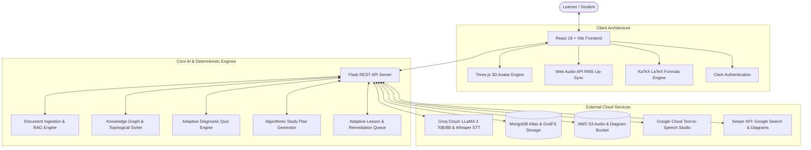

# 🎓 LearnForge

> **Next-Generation AI Personalized Tutoring & Multi-Modal Adaptive Learning Platform**

[](https://github.com/Aditya9207/LearnForge_frontend)
[](https://github.com/Aditya9207/LearnForge_backend-)
[](https://groq.com/)
[](https://threejs.org/)
[](https://www.mongodb.com/)
[](https://aws.amazon.com/s3/)
[](https://cloud.google.com/text-to-speech)

---

## 🔗 Project Ecosystem & Repositories

| Repository | Description | Direct Link |
| :--- | :--- | :--- |
| 🌐 **Main Repository** | Master project hub containing submodules and architecture documentation | [https://github.com/Aditya9207/LearnForge.git](https://github.com/Aditya9207/LearnForge.git) |
| 💻 **Frontend Repository** | React 18, Vite, TypeScript, Three.js 3D Avatar, Web Audio RMS Lip-Sync | [https://github.com/Aditya9207/LearnForge_frontend.git](https://github.com/Aditya9207/LearnForge_frontend.git) |
| ⚙️ **Backend Repository** | Python 3.11+, Flask REST API, Groq LLaMA 3 RAG, Knowledge Graph Engine | [https://github.com/Aditya9207/LearnForge_backend-.git](https://github.com/Aditya9207/LearnForge_backend-.git) |

---

## 🌟 Overview

**LearnForge** transforms static educational content (textbooks, research PDFs, lecture slides, or topic keywords) into an intelligent, adaptive, and multi-modal learning experience. 

Unlike conventional chatbots that simply summarize text, LearnForge acts as a **true pedagogical tutor**:
1. It decomposes complex subjects into **directed prerequisite knowledge graphs**.
2. It assesses baseline competence with an **adaptive diagnostic quiz**.
3. It dynamically sequences a **mastery-banded study plan** tailored to the learner's available time.
4. It executes a **"Teach $\rightarrow$ Check $\rightarrow$ Adapt" loop**, automatically inserting **micro-remediation lessons** whenever foundational prerequisites are missing.
5. It brings learning to life using a **real-time client-side 3D talking avatar** with procedural lip-syncing, LaTeX formula rendering, and contextual diagram injection.

---

## 🏛️ System Architecture



---

## ✨ Key Features

### 1. 🗣️ Real-Time 3D Talking Avatar with Procedural Lip-Sync
- **Zero Video Latency / Zero External Streaming Costs**: Instead of relying on expensive pre-rendered video streaming (e.g. Tavus/HeyGen), LearnForge renders a 3D avatar head (`face9.glb`) directly inside the browser using **Three.js** and **WebGL**.
- **Real-Time RMS Lip-Sync**: Uses the browser's native **Web Audio API** (`AudioContext` + `AnalyserNode`) to calculate the real-time Root-Mean-Square (RMS) amplitude of audio playback and procedurally drives the 3D model's jaw and mouth morph targets in exact synchronization with speech.
- **Futuristic Stage**: Housed in a glassmorphic viewport with glowing concentric rings, topic tags, and mastery badges.

### 2. 🧠 Prerequisite Knowledge Graphs (`knowledge_graph.py`)
- Automatically parses document sections and structures them into discrete topic nodes.
- Proposes prerequisite edges between topics, strictly validated in Python to ensure validity and prevent circular cycles.
- Orders curriculum traversal using **Kahn's Topological Sort Algorithm**.

### 3. 🎯 Adaptive Diagnostic Engine (`diagnostic.py`)
- Evaluates student ability through targeted Multiple Choice Questions (MCQs).
- **Deterministic Grading**: Verification is executed in Python against server-known answer keys—preventing the LLM from grading its own questions or hallucinating scores.
- **Mastery Math**: Updates mastery systematically ($+0.20$ on correct, $-0.15$ on incorrect). Identifies specific misconceptions and branches backwards to test foundational concepts on failure.

### 4. 📅 Algorithmic Study Planner (`planner.py`)
- Combines `topic_graph + mastery_scores + target_goal + time_budget` into a sequenced schedule.
- Allocates time based on empirical mastery bands:
  - `< 60%`: **Teach** (15 min per topic — in-depth concept breakdown)
  - `60% - 75%`: **Practice** (10 min per topic — worked examples and active application)
  - `75% - 90%`: **Apply** (7 min per topic — advanced challenge exercises)
  - `> 90%`: **Review** (3 min per topic — quick refresher)
- Dynamically selects optimal delivery styles: `worked_example`, `socratic`, `direct_explanation`, or `review`.

### 5. 🔄 "Teach $\rightarrow$ Check $\rightarrow$ Adapt" Lesson Loop (`lesson.py`)
- Delivers one pedagogical topic at a time.
- Requires passing a conceptual checkpoint before progressing.
- **Remediation Queue**: If a checkpoint is failed and a prerequisite is weak, a **micro-lesson** is dynamically scheduled before returning to the parent topic.
- **Pedagogical Strategy Rotation**: Re-teaches using alternative modalities (up to 3 attempts) to avoid learner deadlocks.

### 6. 📚 Resizable Multi-Column Learning Hub
- **Column 1**: 3D Talking Avatar + live educational reference links fetched via Serper Google Search.
- **Column 2**: Formatted document summary with **KaTeX LaTeX math formulas** and automatically injected educational diagrams.
- **Column 3**: Context-aware RAG assistant chat with **Groq Whisper voice input** and speech narration.

### 7. 📝 Comprehensive Assessment Suite
- **Interactive MCQ Mode**: Features randomized options, on-demand hints, explanations, and instant score tracking.
- **Theoretical Assessment Mode**: Evaluates free-form paragraph responses, scoring comprehension, partial credit, and providing tailored feedback.

### 8. ⚡ Dual-Pipeline RAG System
- **Pipeline 1 (Active Default - PageIndex Vectorless RAG)**: Extremely memory-efficient (<80 MB RAM), ideal for free-tier cloud containers (e.g. Render 500MB tier).
- **Pipeline 2 (Traditional Vector RAG)**: Full dense vector embeddings using PyTorch, HuggingFace, LangChain, and Qdrant. Toggleable in minutes via [`PIPELINE_TOGGLE_GUIDE.md`](./LearnForgeBackend/PIPELINE_TOGGLE_GUIDE.md).

---

## 🛠️ Complete Tech Stack

| Domain | Technologies |
| :--- | :--- |
| **Frontend Core** | React 18, TypeScript, Vite, React Router DOM |
| **Frontend Styling** | TailwindCSS, PostCSS, Glassmorphism UI tokens, Lucide Icons |
| **3D & Audio Lip-Sync** | Three.js, GLTFLoader (`face9.glb`), Web Audio API (`AnalyserNode`) |
| **Math & Markdown** | `react-markdown`, `remark-math`, `remark-gfm`, `rehype-katex`, `rehype-raw`, KaTeX |
| **Backend Core** | Python 3.11+, Flask, Flask-CORS, Flask-Limiter, Gunicorn, Werkzeug |
| **AI & LLM Inference** | Groq API (LLaMA 3 70B / 8B, Groq Whisper Speech-to-Text) |
| **Databases & Storage** | MongoDB Atlas, MongoDB GridFS (chunked audio), AWS S3 (`boto3`) |
| **Text-to-Speech** | Google Cloud Text-to-Speech (Studio voices: `en-US-Studio-O`) with `gTTS` fallback |
| **Search & Scraping** | Serper API (Google Search & Image Scraping for educational diagrams) |
| **Authentication** | Clerk Auth (`@clerk/react`, `pyjwt[crypto]`) |

---

## 📂 Repository Directory Layout

```
LearnForge/
├── .gitmodules                 # Git submodules definition
├── .gitignore                  # Monorepo gitignore
├── README.md                   # Master project documentation
├── LearnForgeFrontend/         # [Submodule] React 18 + Vite + Three.js Client
│   ├── client/
│   │   ├── components/         # 3D Avatar, Tutor, Diagnostic, Lesson, Skeletons
│   │   ├── pages/              # Home, Study Room, Terms, Privacy
│   │   ├── lib/                # API service, Clerk auth headers, Toast context
│   │   └── App.tsx             # Root router
│   ├── public/                 # 3D assets (face9.glb) & static images
│   ├── package.json
│   └── vite.config.ts
└── LearnForgeBackend/          # [Submodule] Python + Flask REST API Server
    ├── test_groq.py            # Primary Flask application & endpoints
    ├── ingest.py               # Document parsing & PageIndex tree extraction
    ├── knowledge_graph.py      # Prerequisite graph extraction & topological order
    ├── diagnostic.py           # Adaptive diagnostic quiz & mastery calculation
    ├── planner.py              # Algorithmic study planner & time budgets
    ├── lesson.py               # Lesson loop & remediation queue
    ├── groq_client.py          # Key rotation & exponential backoff
    ├── gcp_tts.py              # Google Cloud TTS with gTTS fallback
    ├── image_finder.py         # Serper diagram search & S3 uploader
    ├── requirement.txt         # Python dependencies
    └── PIPELINE_TOGGLE_GUIDE.md# RAG pipeline toggle documentation
```

---

## 🚀 Quickstart & Setup Guide

### 1. Clone the Entire Platform (with Submodules)
```bash
git clone --recurse-submodules https://github.com/Aditya9207/LearnForge.git
cd LearnForge
```

*(If you already cloned without `--recurse-submodules`, run `git submodule update --init --recursive`)*

---

### 2. Backend Setup (`LearnForgeBackend`)

```bash
cd LearnForgeBackend

# 1. Create and activate Python virtual environment
# Windows (PowerShell):
python -m venv .venv
.\.venv\Scripts\Activate.ps1

# macOS / Linux:
python3 -m venv .venv
source .venv/bin/activate

# 2. Install dependencies
pip install -r requirement.txt

# 3. Configure environment variables
cp .env.example .env
# Edit .env and supply your GROQ_API_KEY, MONGO_URI, AWS_*, GCP_TTS_*, and CLERK_* keys

# 4. Start Flask server
python test_groq.py
```
> The API server will be live on `http://localhost:5000`.

---

### 3. Frontend Setup (`LearnForgeFrontend`)

```bash
cd ../LearnForgeFrontend

# 1. Install dependencies
npm install

# 2. Configure environment variables
# Create .env with:
# VITE_API_BASE_URL=http://localhost:5000
# VITE_CLERK_PUBLISHABLE_KEY=pk_test_...

# 3. Start development server
npm run dev
```
> Open your browser and navigate to `http://localhost:5173`.

---

## 📡 Core API Endpoints

| Method | Endpoint | Description |
| :--- | :--- | :--- |
| `GET` | `/api/health` | Service health status |
| `POST` | `/api/upload` | Upload PDF or input topic name for ingestion |
| `GET` | `/api/processing-status/<file>` | Check document ingestion progress |
| `GET` | `/api/files` | Retrieve list of uploaded documents |
| `POST` | `/api/qa` | Query the AI assistant with RAG context |
| `GET` | `/api/get_text` | Retrieve generated document summary |
| `GET` | `/api/get_links` | Get web-scraped educational reference links |
| `POST` | `/api/learning-tts` | Generate audio narration for document summary |
| `GET` | `/api/tts-audio/<id>` | Stream audio directly from MongoDB GridFS |
| `POST` | `/api/qa-voice` | Voice-to-text question answering (Groq Whisper) |
| `GET` | `/api/assessment/generate` | Generate theoretical or MCQ questions |
| `POST` | `/api/assessment/submit` | Submit and grade assessment answers |
| `GET` | `/api/tutor/topics` | Retrieve prerequisite knowledge graph |
| `POST` | `/api/tutor/diagnostic/start` | Start adaptive diagnostic assessment |
| `POST` | `/api/tutor/diagnostic/answer` | Submit diagnostic answer and update mastery |
| `POST` | `/api/tutor/plan/generate` | Generate sequenced, time-budgeted study plan |
| `POST` | `/api/tutor/lesson/next` | Deliver next pedagogical lesson or micro-remediation |
| `POST` | `/api/tutor/lesson/checkpoint` | Grade lesson checkpoint and determine next step |

---

## 🤝 Contributing

Contributions, issues, and feature requests are welcome! Feel free to check the [issues page](https://github.com/Aditya9207/LearnForge/issues).

---

## 📄 License

This project is licensed under the **MIT License**.
